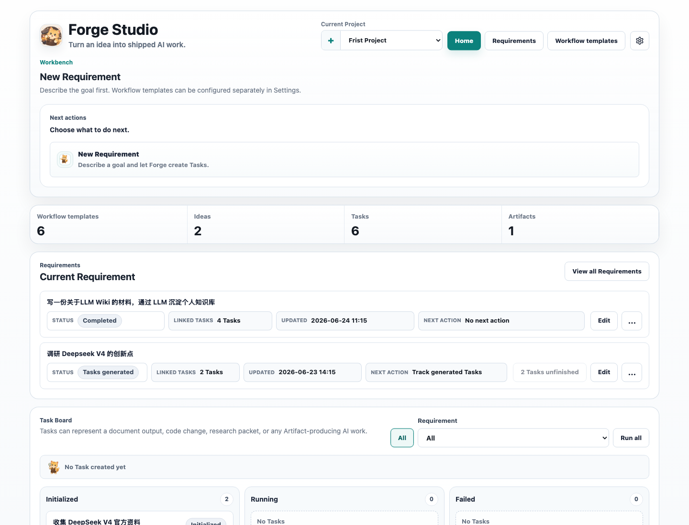
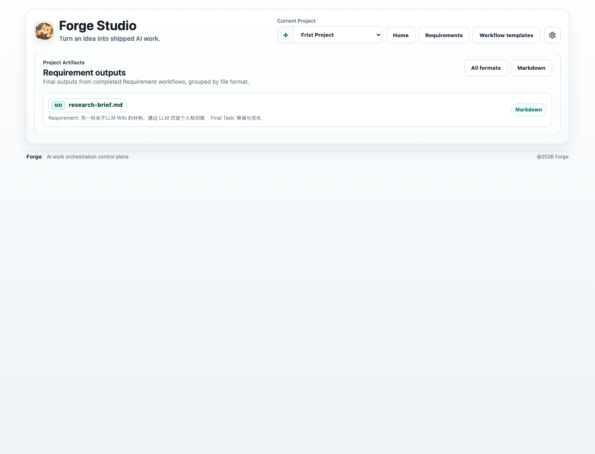

<div align="center">
  
  <h1>Forge</h1>
  <p><strong>AI work orchestration control plane.</strong></p>
  <p>
    Turn a Requirement into Tasks, Task Workflow Runs, Artifacts, review, retry,
    and explicit acceptance without losing the work history around each run.
  </p>
  <p>
    <a href="./README.md">English</a> ·
    <a href="./README.zh-CN.md">中文</a>
  </p>
  <p>
    
    
    
    
    
  </p>
</div>





Forge is not an IDE, a chat window, or an agent runtime. Forge is the control
plane around agentic work: it keeps Projects, Requirements, Tasks, Workflow
Files, Workflow Runs, Node Runs, Artifacts, and acceptance decisions connected
in one operational surface.

The Harness owns execution. Local or remote agents keep their own tools,
credentials, workspaces, and commands. Forge owns orchestration, state,
inspection, retry, artifact review, and human acceptance.

## Current Feature Review

The current product path is now coherent end to end:

1. Create or select a Project.
2. Create a Requirement from the goal description.
3. Generate and edit the Decomposition Result.
4. Generate Tasks from the approved decomposition.
5. Choose a task-scope `.wf` Workflow File and run Task Workflow Runs.
6. Inspect Node Runs, process output, and produced Artifacts.
7. Accept or rerun Task output.
8. Accept the Requirement once linked Tasks are finished.
9. Review final Requirement Artifacts on the dedicated Artifacts page.

Recent functional cleanup:

- Requirement acceptance now completes all linked finished Tasks, not just the
  final Task.
- Completed Requirements show `No next action` instead of an action-like review
  prompt.
- Requirement Artifacts moved out of the home workspace and into the Artifacts
  page.
- The home progress ribbon now includes an Artifacts count that links to the
  Artifacts page.
- Markdown Artifact preview uses an internal scroll area that can reach the
  bottom of long documents.
- English and Chinese README screenshots are captured from matching routes,
  viewport sizes, and project state.

## Core Loop

```text
Requirement
  -> Decomposition Result
  -> Tasks
  -> Task Workflow Runs
  -> Node Runs
  -> Artifacts
  -> review / retry / accept
```

| Layer | Forge tracks | Why it matters |
| --- | --- | --- |
| Intent | Requirement | Work starts from a durable goal, not a lost prompt |
| Planning | Decomposition Result and Tasks | Generated work can be edited before execution |
| Execution | Task Workflow Runs and Node Runs | Agent work is visible, retryable, and inspectable |
| Evidence | Artifacts | Outputs survive the chat or CLI session that created them |
| Judgment | Review and acceptance | Completion is a user decision, not just a process exit |

## What You Get

- A browser control plane for Projects, Requirements, Tasks, Workflow Files,
  Agent Bindings, Skills, Artifacts, and settings.
- A Task Board for scanning generated work, dependency status, and Task Workflow
  Runs.
- A Workflow Run detail view for Node Run status, logs, process output,
  artifacts, retries, and blocked states.
- A dedicated Artifacts page for final Requirement outputs, grouped by format.
- Local-first Bridge execution through `forgecli`.
- Model execution settings for OpenAI, Anthropic, Google Gemini, Mistral, Groq,
  DeepSeek, OpenRouter, Ollama, LM Studio, and OpenAI-compatible endpoints via
  the Vercel AI SDK.
- A TypeScript monorepo with pure workflow/domain logic in `packages/core`,
  persistence in `packages/db`, and a typed SDK in `packages/sdk`.

## Quickstart

Requirements:

- Node.js 22+
- pnpm 9+

Run Forge locally:

```bash
pnpm install
pnpm start
```

Open:

```text
http://localhost:3001
```

Forge serves the Web console and API from the same port. API routes are under
`/api/*`, for example:

```text
http://localhost:3001/api/health
```

For development watch mode:

```bash
pnpm --filter @forge/forge dev
```

The browser URL is still `http://localhost:3001`; Forge does not use a separate
Vite browser port for normal development.

## Connect Agents

Build `forgecli`, bind the Bridge, register agents, and start polling for work:

```bash
pnpm build:forgecli
apps/forgecli/dist/index.js bridge bind --server http://localhost:3001
apps/forgecli/dist/index.js agent add codex --connector mcp --command "codex mcp-server" --tool codex
apps/forgecli/dist/index.js agent add coco --connector cli --command "coco run"
apps/forgecli/dist/index.js bridge start
apps/forgecli/dist/index.js bridge status
```

CLI Connector agents receive the Bridge job payload as JSON on stdin and report
success or failure through their process exit code. MCP Connector agents are
started over stdio and invoked through `tools/call`.

## Workflow Files

Forge workflows are defined with `.wf` files. The MVP workflow model is
DAG-based: nodes declare inputs, outputs, dependencies, skills, artifacts,
agents, Exit Criteria, retry instructions, and optional human review.

```text
Workflow File
  -> Workflow Nodes
  -> dependencies
  -> Exit Criteria
  -> retries
  -> Artifacts
  -> review
```

Forge intentionally avoids arbitrary runtime loops, `goto`, or generated nodes
in the MVP. The loop is explicit at the control-plane level, where each run can
be reviewed, retried, accepted, and audited.

## Architecture

| Path | Purpose |
| --- | --- |
| `apps/forge` | Forge Web console and API server |
| `apps/forgecli` | `forgecli` command-line entry point and Bridge commands |
| `packages/core` | `.wf` parsing, DAG planning, artifact output normalization, and workflow domain logic |
| `packages/db` | SQLite and Drizzle data access layer |
| `packages/sdk` | TypeScript client SDK |
| `packages/ui` | Shared React UI components |
| `docs/adr` | Architecture decision records |
| `docs/issues` | Local markdown issues used for staged planning |

## Configuration

Forge uses SQLite by default. Local development data is stored under:

```text
apps/forge/.forge/forge.sqlite
```

Common runtime settings:

| Setting | Description | Default |
| --- | --- | --- |
| `PORT` | API and bundled web server port | `3001` |
| `FORGE_WEB_ASSETS_ROOT` | Directory containing built web assets | bundled app assets |
| `FORGE_SQLITE_PATH` | SQLite database file path | `apps/forge/.forge/forge.sqlite` |

Reset local development data:

```bash
rm -rf apps/forge/.forge
```

Do not commit local database files, model API keys, bridge tokens, or generated
artifacts.

## Scripts

```bash
pnpm test
pnpm typecheck
pnpm build
pnpm lint
pnpm release
```

Focused checks:

```bash
pnpm --filter @forge/forge test -- src/app.test.ts web/src/App.test.tsx
pnpm --filter @forge/db test -- src/project-repository.test.ts
pnpm --filter @forge/sdk test -- src/index.test.ts
pnpm --filter @forge/forge typecheck
pnpm --filter @forge/forge build
```

## Project Status

Forge is early-stage software. The implemented path covers Project setup,
Requirement creation, decomposition, Task generation, task-scope Workflow Runs,
Node Run inspection, Artifact preview, Task acceptance, Requirement acceptance,
and final Requirement Artifact review.

Still evolving:

- full worktree lifecycle policy
- cloud Artifact storage adapters
- richer external Artifact publishing
- complete local and remote Agent Connector coverage
- broader Exit Criteria semantics beyond the current model-reviewed path

APIs, storage shape, and UI details can still change.

## Security Notes

- Forge Server does not need to reverse-connect into a user's machine. Local or
  remote Harness integrations should connect outbound to Forge.
- Realtime updates are SSE-first, while user actions should go through HTTP
  APIs.
- Do not publish `.forge` databases, `.env*` files, private keys, certificates,
  bridge tokens, model API keys, or local agent credentials.
- Test fixtures may use placeholder strings such as `secret-key`; these are not
  real credentials.

If you believe you found a security issue, please do not open a public issue
with exploit details. Contact the maintainers through the project's preferred
private reporting channel once one is published.

## License

No license file is included yet. Add a `LICENSE` file before publishing this
repository as open source.
