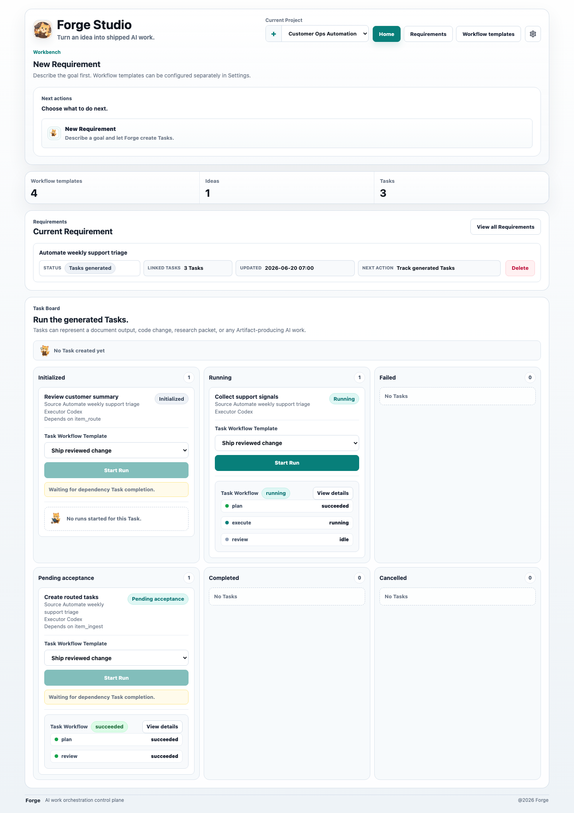

<div align="center">
  
  <h1>Forge</h1>
  <p><strong>The control plane for agentic work loops.</strong></p>
  <p>
    Turn a Requirement into a governed loop of Tasks, Workflow Runs, Agent execution,
    Artifacts, review, retry, and acceptance.
  </p>
  <p>
    <a href="./README.md">English</a> ·
    <a href="./README.zh-CN.md">中文</a>
  </p>
  <p>
    
    
    
    
    
  </p>
</div>



Forge is not another chat window, execution surface, or agent runtime. It is the
missing operating layer around local and remote agents: Projects, Requirements,
Tasks, `.wf` Workflow Files, Agent Bindings, Node Runs, Artifacts, and explicit
human acceptance.

## The Loop

Most agent tools optimize a single run. Forge manages the loop around every run.

```text
Requirement
  -> Decomposition Result
  -> Tasks
  -> Workflow Run
  -> Node Runs
  -> Artifact Versions
  -> review / retry / accept
  -> next run with history intact
```

| Loop layer | Forge keeps track of | Why it matters |
| --- | --- | --- |
| Intent | Requirement and Decomposition Result | Work starts from a goal, not a lost prompt |
| Plan | Tasks and dependencies | Generated work can be edited, ordered, and approved |
| Execution | Workflow Run and Node Runs | Agent work is visible, retryable, and inspectable |
| Evidence | Artifact Versions and logs | Outputs survive the chat or CLI session that made them |
| Judgment | Exit Criteria and human review | Completion is an acceptance decision, not just a process exit |

The Harness owns execution: model credentials, tools, files, commands,
worktrees, and external services. Forge owns the control plane around that
execution.

## Why Forge Exists

- **Chats do not preserve operations.** Forge keeps status, owners, retries,
  artifacts, and acceptance decisions attached to a Project.
- **Single agents do not make a workflow.** Forge turns reusable `.wf` Workflow
  Files into DAG-based loops with node-local retries and review points.
- **Local execution still needs coordination.** Forge can assign work to local
  CLI or MCP agents without taking over their runtime or credentials.
- **Outputs need a lifecycle.** Forge treats outputs as Artifacts with versions,
  review state, and a path to acceptance.

## What You Get

- A browser-based control plane for Requirements, Tasks, Workflow Files, Agent
  Bindings, Skills, Artifacts, and settings.
- A Task Board for scanning generated work and starting Task Workflow Runs.
- A Control Room view for Node Run status, assigned agents, logs, artifacts,
  retries, waiting states, and blocked work.
- Local-first Bridge execution through `forgecli`.
- Model execution settings for OpenAI, Anthropic, Google Gemini, Mistral, Groq,
  DeepSeek, OpenRouter, Ollama, LM Studio, and OpenAI-compatible endpoints via
  the Vercel AI SDK.
- A TypeScript monorepo with pure workflow/domain logic in `packages/core`,
  persistence in `packages/db`, and a typed SDK in `packages/sdk`.

## Quickstart

Requirements:

- Node.js 22+
- pnpm 9+

Run Forge locally:

```bash
pnpm install
pnpm start
```

Open:

```text
http://localhost:3001
```

Forge serves the Web console and API from the same port. API routes are under
`/api/*`, for example:

```text
http://localhost:3001/api/health
```

For development watch mode:

```bash
pnpm --filter @forge/forge dev
```

The browser URL is still `http://localhost:3001`; Forge does not use a separate
Vite browser port for normal development.

## Connect Agents

Build `forgecli`, bind the Bridge, register agents, and start polling for work:

```bash
pnpm build:forgecli
apps/forgecli/dist/index.js bridge bind --server http://localhost:3001
apps/forgecli/dist/index.js agent add codex --connector mcp --command "codex mcp-server" --tool codex
apps/forgecli/dist/index.js agent add coco --connector cli --command "coco run"
apps/forgecli/dist/index.js bridge start
apps/forgecli/dist/index.js bridge status
```

CLI Connector agents receive the Bridge job payload as JSON on stdin and report
success or failure through their process exit code. MCP Connector agents are
started over stdio and invoked through `tools/call`.

## Workflow Files

Forge workflows are defined with `.wf` files. The MVP workflow model is
DAG-based: nodes declare inputs, outputs, dependencies, skills, artifacts,
agents, Exit Criteria, retry instructions, and optional human review.

```text
Workflow File
  -> Workflow Nodes
  -> dependencies
  -> Exit Criteria
  -> retries
  -> Artifacts
  -> review
```

Forge intentionally avoids arbitrary runtime loops, `goto`, or generated nodes
in the MVP. The loop is explicit at the control-plane level, where each run can
be reviewed, retried, accepted, and audited.

## Architecture

| Path | Purpose |
| --- | --- |
| `apps/forge` | Forge web console and API server |
| `apps/forgecli` | `forgecli` command-line entry point and Bridge commands |
| `packages/core` | `.wf` parsing, DAG planning, and workflow domain logic |
| `packages/db` | SQLite and Drizzle data access layer |
| `packages/sdk` | TypeScript client SDK |
| `packages/ui` | Shared React UI components |
| `docs/adr` | Architecture decision records |
| `docs/issues` | Local markdown issues used for staged planning |

## Configuration

Forge uses SQLite by default. Local development data is stored under:

```text
apps/forge/.forge/forge.sqlite
```

Common runtime settings:

| Setting | Description | Default |
| --- | --- | --- |
| `PORT` | API and bundled web server port | `3001` |
| `FORGE_WEB_ASSETS_ROOT` | Directory containing built web assets | bundled app assets |
| `FORGE_SQLITE_PATH` | SQLite database file path | `apps/forge/.forge/forge.sqlite` |

Reset local development data:

```bash
rm -rf apps/forge/.forge
```

Do not commit local database files, model API keys, bridge tokens, or generated
artifacts.

## Scripts

```bash
pnpm test
pnpm typecheck
pnpm build
pnpm lint
pnpm release
```

Focused checks:

```bash
pnpm --filter @forge/forge test -- src/app.test.ts
pnpm --filter @forge/db test -- src/project-repository.test.ts
pnpm --filter @forge/forge typecheck
pnpm --filter @forge/forge build
```

## Project Status

Forge is early-stage software. The current implementation focuses on the core
path:

1. Create a Project.
2. Import a requirement-scope `.wf` Workflow File.
3. Create a Requirement and generate a Decomposition Result with a mock executor
   or a configured OpenAI-compatible model endpoint.
4. Edit the Decomposition Result and generate Tasks.
5. Import a task-scope `.wf` Workflow File.
6. Start a Task Workflow Run from the Task Board.
7. Inspect Workflow Run and Node Run status in the Control Room.

Full worktree lifecycle policy, Artifact Version storage, SSE event streaming,
and complete Exit Criteria retry semantics are still being completed. APIs,
storage shape, and UI details can still change.

## Security Notes

- Forge Server does not need to reverse-connect into a user's machine. Local or
  remote Harness integrations should connect outbound to Forge.
- Realtime updates are SSE-first, while user actions should go through HTTP
  APIs.
- Do not publish `.forge` databases, `.env*` files, private keys, certificates,
  bridge tokens, model API keys, or local agent credentials.
- Test fixtures may use placeholder strings such as `secret-key`; these are not
  real credentials.

If you believe you found a security issue, please do not open a public issue
with exploit details. Contact the maintainers through the project's preferred
private reporting channel once one is published.

## License

No license file is included yet. Add a `LICENSE` file before publishing this
repository as open source.
