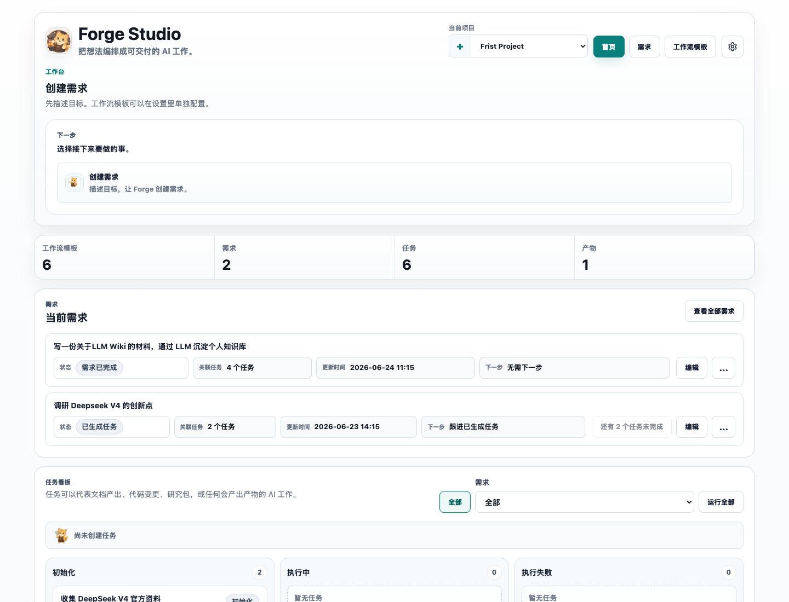
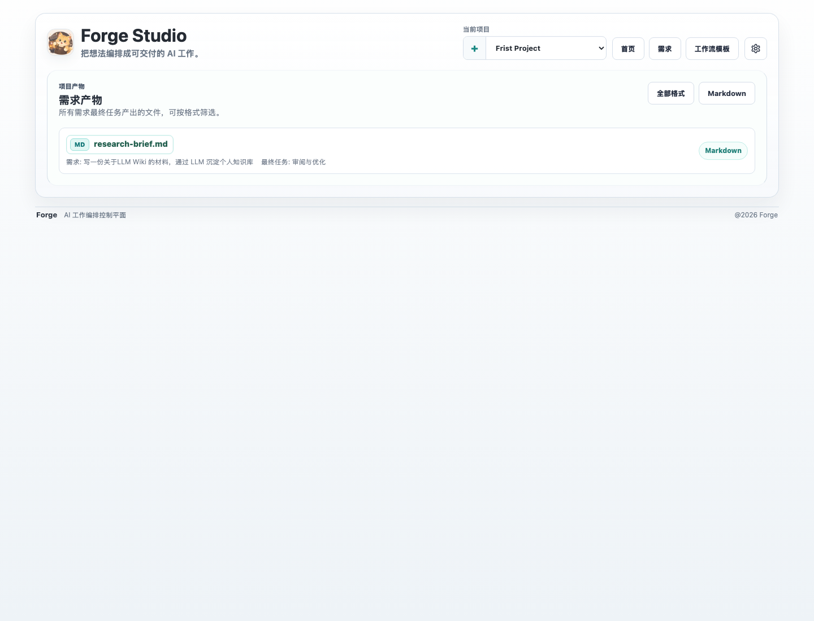

<div align="center">
  
  <h1>Forge</h1>
  <p>AI 工作编排控制平面。</p>
  <p>
    <a href="./README.md">English</a> ·
    <a href="./README.zh-CN.md">中文</a>
  </p>
</div>

Forge 是一个早期阶段的自托管 AI 工作编排控制平面。它记录项目、需求、任务、
任务工作流、节点执行、产物和验收决策；本地或远端 Agent 通过本地桥接执行工作。

当前实现使用 SQLite。项目记录、工作流定义、任务工作流输出、本地桥接输出和执行
配置都保存在 Forge Server。云端产物存储和其他 SQL 数据库后端尚未实现。API、
存储结构和 UI 细节仍可能变化。





## 从源码运行

环境要求：

- Node.js 22+
- pnpm 9+

安装依赖并启动 Forge：

```bash
pnpm install
pnpm start
```

打开 `http://localhost:3001`。Web 控制台和 API 使用同一个端口，健康检查地址为
`http://localhost:3001/api/health`。

开发监听模式：

```bash
pnpm --filter @forge/forge dev
```

浏览器地址仍为 `http://localhost:3001`。

## 当前流程

```text
需求
  -> 拆解结果
  -> 任务
  -> 任务工作流
  -> 节点执行
  -> 产物
  -> 评审 / 重试 / 验收
```

当前版本支持：

- 创建和选择项目；
- 创建需求并生成可编辑的拆解结果；
- 从已确认的拆解结果生成任务；
- 导入任务范围的 `.wf` 工作流模板源文件；
- 启动任务工作流并查看节点执行；
- 查看执行输出和产物；
- 重试节点，并验收任务或需求产物；
- 配置模型提供方和本地 Agent 绑定。

工作流引擎基于 DAG，并使用节点内重试。当前模型不支持任意循环、`goto` 或运行时
生成节点。

## 连接 Agent

构建 `forgecli`、绑定本地桥接、注册 Agent，然后开始轮询任务：

```bash
pnpm build:forgecli
apps/forgecli/dist/index.js bridge bind --server http://localhost:3001
apps/forgecli/dist/index.js agent add codex --connector mcp --command "codex mcp-server" --tool codex
apps/forgecli/dist/index.js agent add my-agent --connector cli --command "my-agent run"
apps/forgecli/dist/index.js bridge start
apps/forgecli/dist/index.js bridge status
```

CLI 连接方式通过标准输入接收本地桥接任务的 JSON，并通过进程退出码报告成功或
失败。MCP 连接方式通过 stdio 启动 Agent，并通过 `tools/call` 调用。

## 工作流模板

Forge 把 `.wf` 文件导入为工作流模板。工作流模板源文件可以声明节点、输入、输出、
依赖、Skill、产物、Agent 角色、验收条件、重试说明和可选人工评审。

Web 控制台提供示例模板。解析、校验、DAG 规划和工作流状态转换位于
`packages/core`。

## 仓库结构

| 路径 | 说明 |
| --- | --- |
| `apps/forge` | Forge Web 控制台和 API Server |
| `apps/forgecli` | `forgecli` 命令入口和本地桥接命令 |
| `packages/core` | `.wf` 解析、DAG 规划、输出规整和工作流领域逻辑 |
| `packages/db` | SQLite 和 Drizzle 数据访问 |
| `packages/sdk` | TypeScript 客户端 SDK |
| `packages/ui` | 共享 React UI 组件 |
| `docs/adr` | 架构决策记录 |
| `docs/issues` | 历史本地规划记录 |

## 数据和配置

默认 SQLite 数据库位于：

```text
apps/forge/.forge/forge.sqlite
```

| 配置 | 说明 | 默认值 |
| --- | --- | --- |
| `PORT` | API 和打包后 Web Server 的端口 | `3001` |
| `FORGE_HOST` | Server 监听地址 | `127.0.0.1` |
| `FORGE_AUTH_TOKEN` | Server token；未配置时生成在 `~/.forge/auth-token` | 自动生成 |
| `FORGE_WEB_ASSETS_ROOT` | 构建后 Web 资产目录 | 打包后的应用资产 |
| `FORGE_SQLITE_PATH` | SQLite 数据库文件路径 | `apps/forge/.forge/forge.sqlite` |

非 loopback 监听必须使用 Server token。远端部署还应在可信反向代理层配置 TLS 和
额外网络访问控制。

模型 API Key 以未加密文本保存在 Forge Server 的 SQLite 数据库中；保存后，设置
接口不会返回 Key 内容。请保护数据库、数据库备份、运行 Forge 的系统账号和生成的
产物。

部署安全边界和私密漏洞报告流程见 [SECURITY.md](./SECURITY.md)。

## 当前限制

- SQLite 是当前唯一实现的数据库后端。
- 产物和任务工作流输出由 Forge Server 保存；云端产物存储尚未实现。
- API 和持久化数据结构尚未稳定。
- Agent 连接方式覆盖和验收条件行为仍在演进。

## 开发检查

```bash
pnpm test
pnpm typecheck
pnpm build
pnpm lint
```

聚焦检查：

```bash
pnpm --filter @forge/forge test -- src/app.test.ts web/src/App.test.tsx
pnpm --filter @forge/db test -- src/project-repository.test.ts
pnpm --filter @forge/sdk test -- src/index.test.ts
pnpm --filter @forge/forge typecheck
```

## 许可证

Forge 使用 [Apache License 2.0](./LICENSE)。
